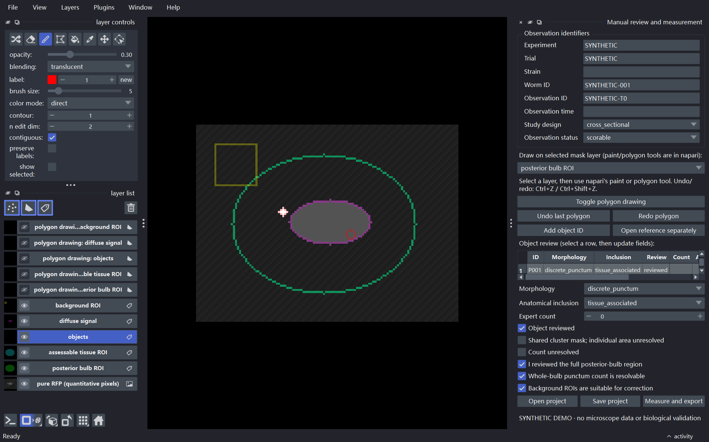

# C. elegans pharynx quantification

A local desktop application for human-guided measurements of RFP signal in the *C. elegans* posterior pharyngeal bulb. You decide the anatomy, object identity, tissue versus lumen, and review status. The software stores your masks and applies deterministic measurements to original TIFF pixels.

This first version supports single-channel 2D grayscale TIFF and OME-TIFF. It does not read CZI, RGB, stacks, projections, or 3D data. It has no detector or trained model. A punctum is an image-defined focus; fluorescence measurements are not bacterial cell counts or CFU.

## Install and launch (Windows)

Install Python 3.11 or newer, then in PowerShell from the downloaded project folder:

```powershell
py -3.12 -m venv .venv
.\.venv\Scripts\Activate.ps1
python -m pip install --upgrade pip
python -m pip install -e ".[dev]"
celegans-pharynx-quant
```

The application asks you to open a pure-RFP TIFF. Select one mask layer in the dock and use napari's paint/erase tools, or switch on polygon drawing. Add an object ID before painting its punctum. Set morphology, anatomical inclusion, and review status independently. Draw the posterior-bulb ROI, assessable-tissue ROI, and reviewed background ROI on their own layers. Napari's layer list lets you select objects, change display opacity, or hide an overlay. Use napari's Ctrl+Z / Ctrl+Shift+Z for brush edits and the dock's polygon undo/redo buttons for polygon masks.

Enter experiment, trial, strain, worm, observation, and time information in the dock. Mark full bulb coverage only after reviewing it. A reference TIFF opens in a separate viewer and is never registered, used for measurements, or used to transfer coordinates.

The project is saved as a `.cephq` folder containing `project.json` and lossless `masks.npz`. It is created next to the input image by default; choose another directory with **Save project** to keep research data outside this repository. Autosave writes masks and review metadata after edits. **Measure and export** writes `objects.csv`, `observations.csv`, `approved_masks.tif`, and a display-only `qc_overlay.tif` beside the project metadata. Run `cephq-measure path\to\project.json` to remeasure a saved project.

## What this version does

| Capability | State |
|---|---|
| Manual ROIs, object masks, separate morphology and inclusion labels | Implemented |
| Constant background estimate from reviewed background mask | Implemented; suitability is a human decision |
| Pixel area and intensity from original image values | Implemented |
| Micron calibration from supported TIFF/OME-TIFF metadata | Implemented when available; otherwise units remain pixels |
| Autosaved local projects and CSV/TIFF exports | Implemented |
| Synthetic software checks | Implemented; not biological validation |
| CZI, stacks, projection, 3D, puncta proposals, model training | Not implemented |



This screenshot contains generated demo data only; it is not a microscope image.

Unreviewed objects do not contribute as tissue-associated puncta. A partial observation does not receive a whole-bulb count. Diffuse tissue mask area is separate and contributes through a union to accepted positive area. If there are no accepted positive pixels, positive-region mean is blank. Background correction retains negative results and is blank when background is empty or marked unsuitable. A cluster with expert count can retain that count while its individual area is undefined.

## Synthetic demo

Create an explicitly synthetic example (not experimental data):

```powershell
cephq-demo .\demo-output
```

This creates a synthetic TIFF, project and expected CSV exports. Never describe this demo as biological validation.

## Development

```powershell
python -m pytest
```

See [AGENTS.md](AGENTS.md), [measurement specification](docs/measurement_spec.md), [annotation guide](docs/annotation_guide.md), [data format](docs/data_format.md), [validation record](docs/validation.md), and [decisions](docs/decisions.md).

The project is currently unlicensed pending confirmation of software ownership and the license to apply. Private images, annotations, outputs and trained weights do not belong in this public repository.
